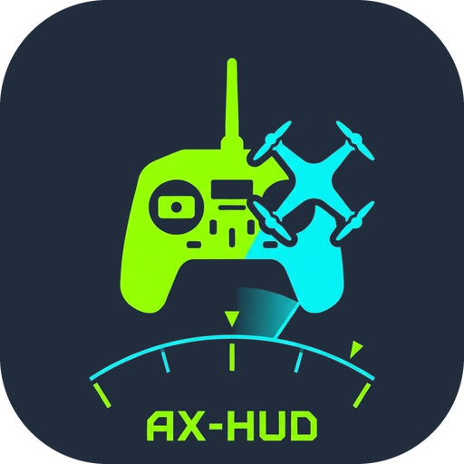

<a href="README.md">English</a> · <a href="README.tr.md">Türkçe</a> · <b>Deutsch</b> · <a href="README.zh.md">中文</a>

# AX-HUD: Videomonitor, HUD und Ansager für die AX12

> **Haftungsausschluss:** AX-HUD ist ein unabhängiges Open-Source-Projekt und steht in keiner offiziellen Verbindung zu RadioMaster; es wird von RadioMaster weder unterstützt noch empfohlen. Die Nutzung erfolgt auf eigenes Risiko. Die App liest Telemetriedaten nur aus und schreibt keine Einstellungen auf die Fernsteuerung. Für deine Ausrüstung, Konfiguration und Flugsicherheit bist allein du verantwortlich.

> **Zum RadioMaster SDK:** Die Release-APK enthält die Bibliotheken des AX SDK von RadioMaster. Im SDK-Repository gibt es keine Lizenzdatei, die Bedingungen für die Weitergabe sind also nicht niedergeschrieben; ich habe RadioMaster im November 2026 zuerst über den Support und dann mit einem Issue im SDK-Repository gefragt und bisher keine Antwort erhalten. Nennen RadioMaster oder die Autoren des SDK Bedingungen oder bitten sie mich aufzuhören, nehme ich die Bibliotheken umgehend aus den Releases. Einzelheiten (Englisch): [README.md](README.md#the-radiomaster-sdk-what-is-settled-and-what-is-not). Das ist keine Rechtsberatung.

**AX-HUD** ist eine Android-App für die RadioMaster AX12. Sie **liest** nur von der Fernsteuerung und schreibt nie eine Einstellung.

## Was sie kann

* Zeigt das Video vom HDMI-Eingang im **Vollbild**; ohne Bild erscheint unten eine schmale Statusleiste, und sie verbindet sich von selbst neu.
* **Spricht Ansagen** nach Regeln, die du selbst schreibst, z. B. `ch5 >= 1500 -> Motoren scharf`. Die Regeln bearbeitest du in der App: Schwellen, `and`/`or`-Logik, Schaltererkennung, Live-Werte wie `{vbat/6:2}`.
* Eine **Warn-Statusleiste** mit derselben Logik (kritisch = rot und blinkend, Warnung = gelb, Info = blau; auf Wunsch nach N Sekunden ausgeblendet).
* **Einblendungen:** Stick-Ansicht und Aux-Schalterbalken (Namen änderbar, umkehrbar), Flugstatistik (Höchstgeschwindigkeit, Maximalhöhe, Spitzenstrom), Radar und Checkliste vor dem Flug.
* **Menü:** neun Kacheln: Soundregeln, Sprache, Akku, Fluggerät und Sonnenlicht in der ersten Reihe; Dashboard/Video, Flugprotokolle, Einstellungen und Beenden in der zweiten.
* **Flug-Logs und Replay:** jeder Flug wird in eine CSV-Datei geschrieben (standardmäßig aus) und auf der Fernsteuerung wiedergegeben: Radar, Sticks, Kanalbalken, Diagramme und eine flüssige **3D-Ansicht** des Flugs (neu in 1.13).
* **Updates von GitHub:** Einstellungen > Updates. Zwei Kanäle: Nightly (jeder Push) und Stable (Releases). Details: [UPDATES.md](UPDATES.md).
* **Sprache:** Englisch, Türkisch, Deutsch, Chinesisch. Einstellungen > Sprache. Die Stimme kann eine andere Sprache sprechen als die Anzeige.

## Neu

**1.13: der 3D-Flugreplay (1.13.0 bis 1.13.4)**

* **3D-Replay.** Ein aufgezeichneter Flug wird hinter den Karten in 3D gezeichnet: ein nach Geschwindigkeit eingefärbtes Band über einem flachen Boden mit Horizont
  und Raster, das Fluggerät, ein grüner HOME-Ring und Flaggen für Start, jeden Flugmodus-Wechsel, das Ende des Genehmigungsfensters, den weitesten Punkt, den
  höchsten Punkt, die Höchstgeschwindigkeit und die Landung.
* **Flüssige Bewegung.** Das Log enthält Position und Lage etwa einmal pro Sekunde; das Fluggerät bewegt sich auf einer glatten Kurve durch diese Punkte
  (unabhängig von der Bildrate), ohne Stufen und Ecken.
* **Drei Kameras, zwei Modelle.** Verfolger, Orbit (ziehen zum Drehen, mit zwei Fingern zoomen) und Pilot; das Fluggerät kann als Quad oder als Flugzeug gezeichnet werden.
* **Die Replay-Leiste blendet sich selbst aus:** nach vier Sekunden ohne Berührung, bei jeder Berührung kommt sie zurück; sie verdeckt so die Sticks und die unteren Karten nicht mehr.
* **Behoben (1.13.2):** Das 3D-Modell zeigte den Nickwinkel (Pitch) falsch herum; im Log ist Pitch bei Nase unten positiv.
* **Besser lesbar (1.13.3, 1.13.4):** ein Pfeil entlang der Flugrichtung und ein Dreieck am Boden, Flugzeug und Quad aus gefüllten Formen, etwas größere Modelle, höhere Verfolgerkamera.

**1.12: Einstellungen in Tabs und ehrliche Logs (1.12.0 und 1.12.1)**

* **Einstellungen in Tabs mit Suchfeld** (1.12.0); die beiden Diagnose-Gruppen wurden zusammengelegt.
* **Behoben (1.12.1):** Die drei RSSI-Spalten eines Flug-Logs wurden als vorzeichenlose Bytes geschrieben (-201 statt -55 dBm); die echte Log-Rate wird angegeben;
  `win_left` ist in Minuten und nach Ende des Fensters negativ; die Spaltenbeschreibungen wurden korrigiert.
* Community-Dateien: Issue-Vorlagen und `SECURITY.md`.

Die vollständige Liste: [CHANGELOG.md](CHANGELOG.md). Details zum 3D-Replay stehen im [englischen README](README.md#3d-replay).

## Voraussetzungen und Installation

* RadioMaster **AX12** (Android 9). Getestet vom Autor: Systemupdate Oktober 2026, INAV 9.1, ExpressLRS. Andere Aufbauten sind **ungetestet**.
* Lade `ax-hud.apk` von der Seite **Releases** herunter (die Version mit dem Patch für die serielle Sperre; sie läuft auf der AX12) und installiere sie.
* **Schließe** die eigene RadioMasterAX-App der AX12: Den seriellen Port kann immer nur eine App nutzen. Beim Schließen von AX-HUD wird er zurückgegeben.

## Umgehung der seriellen Sperre

Das SDK greift über Qt's `QSerialPort` auf die serielle Verbindung zu und erstellt dabei eine Sperrdatei. Da eine Android-App kein beschreibbares Sperrverzeichnis hat, kann die Verbindung möglicherweise nicht geöffnet werden. Dann zeigt „Variablen anzeigen“ `radio config: NOT loaded yet` und `mixout msgs` bleibt auf 0.

* Vor dem SDK-Start setzt die App Qt's temporäres Verzeichnis (`TMPDIR`) auf ihren eigenen Datenordner.
* Um die erforderliche `QSerialPort`-Sperrdatei unter Android zu umgehen, verwendet die App einen Speicher-Patch ähnlich dem der offiziellen Demo. Der Patch ist in `ax-hud.apk` enthalten (die CI baut sie mit `-PaxLockPatch=true`); `ax-hud-plain.apk` ist dieselbe App ohne ihn. Der Patch wird nur angewendet, wenn beide Maschinenbefehle exakt den erwarteten Werten entsprechen.
* Schließe zuerst die RadioMasterAX-App der AX12: Zwei Programme dürfen den seriellen Port nicht gleichzeitig verwenden.
* Suche in `adb logcat` nach `qt`, `serial`, `lock` oder `ax12bridge` sowie nach `Failed to create a lock file`.
* Die dauerhafte Lösung wäre eine offizielle Möglichkeit von RadioMaster, die Verbindung zu öffnen. Bitte RadioMaster darum.

## Sicherheit

Die App ist experimentell und nur als **zweite Informationsquelle** gedacht; sie ersetzt nicht das OSD deines Flugcontrollers. Die Nutzung erfolgt auf eigenes Risiko. Fliege im Rahmen der geltenden Vorschriften. Aktualisiere nie während eines Fluges.

## Datenschutz

Die App verbindet sich für Updates mit github.com und sendet keine Daten an andere Stellen. Wenn ein GPS-Fix vorliegt, speichert sie die letzte bekannte Position auch während des Fluges und bei einem Verbindungsverlust in `last_position.txt` im App-Ordner auf der Fernsteuerung; das ist unabhängig von den Flugprotokollen. Wenn du Flugprotokolle aktivierst (standardmäßig aus), können auch die CSV-Dateien GPS-Positionen enthalten. Drei schnelle Berührungen oben am Bildschirm, nicht auf MENU, speichern einen PNG-Screenshot des ganzen Bildschirms einschließlich sichtbarer Koordinaten in `Pictures/AX-HUD`. Diese Dateien bleiben auf der Fernsteuerung, sofern du sie nicht kopierst. Veröffentliche keine Protokolle oder Screenshots, die zeigen, wo du fliegst.

## Dank

Danke an **RadioMaster** für die Veröffentlichung des AX SDK, das diese App möglich macht. AX-HUD ist ein unabhängiges Projekt und nicht mit RadioMaster verbunden.

Alle Einzelheiten (Bauen, serielle Sperre, Regeln, Tests) stehen im [englischen README](README.md). Korrekturen an den Übersetzungen: [TRANSLATING.md](TRANSLATING.md).

## Lizenz

AX-HUD ist freie Software unter der **GNU General Public License, Version 3 oder später** (GPL-3.0-or-later) mit einer **zusätzlichen Erlaubnis**, die die Verbindung mit dem AX-SDK von RadioMaster gestattet: [LICENSE](LICENSE). Kurz: Du darfst es benutzen, untersuchen, ändern und weitergeben; gibst du eine geänderte Version oder ein darauf aufbauendes Programm weiter, musst du den Quellcode unter derselben Lizenz weitergeben. Der Rechteinhaber kann einer bestimmten Partei eine gesonderte schriftliche Lizenz zu anderen Bedingungen erteilen; sonst niemand. Das RadioMaster-SDK, die Qt-Bibliotheken und die übrigen Teile im APK behalten ihre eigenen Lizenzen; sie sind mit den vollen Texten in [THIRD_PARTY_NOTICES.md](THIRD_PARTY_NOTICES.md) und in der App unter *Einstellungen > Über* aufgeführt. Zu Beiträgen siehe [CONTRIBUTING.md](CONTRIBUTING.md).
