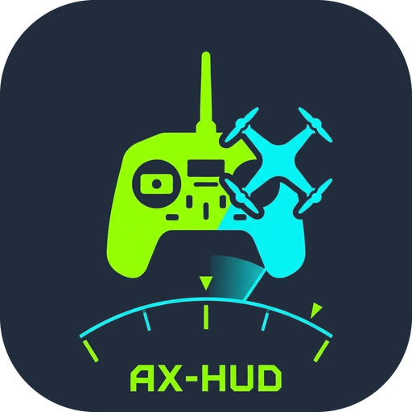
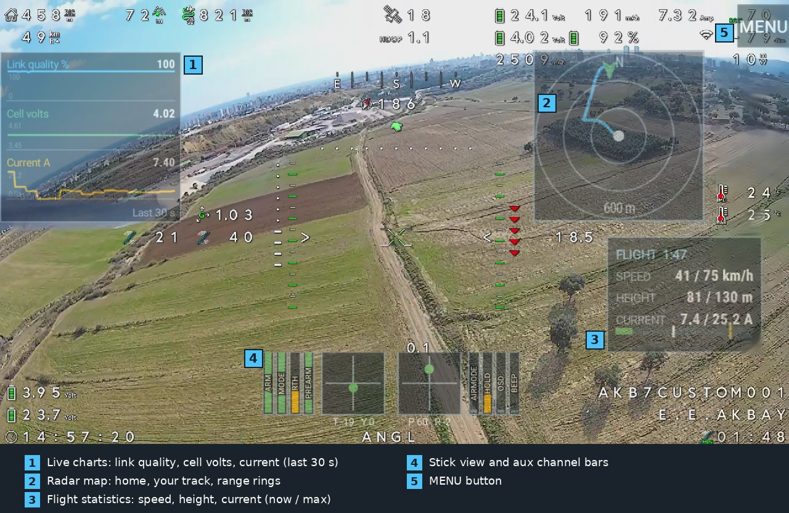
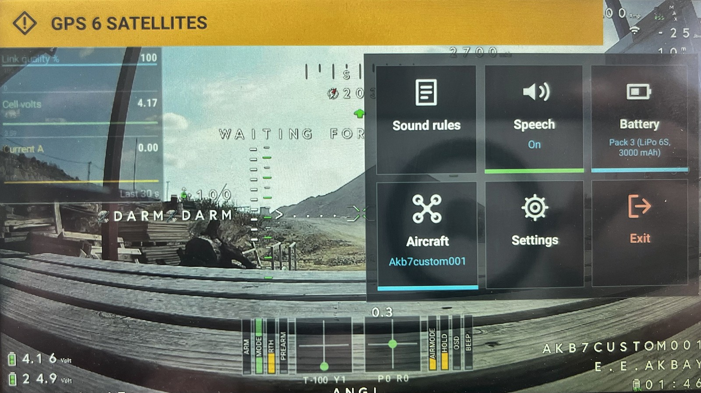
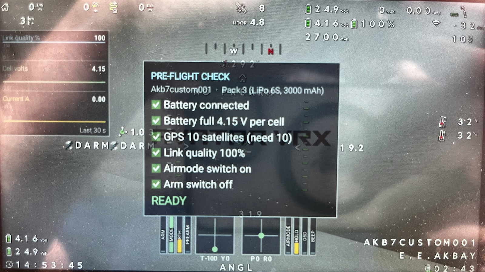
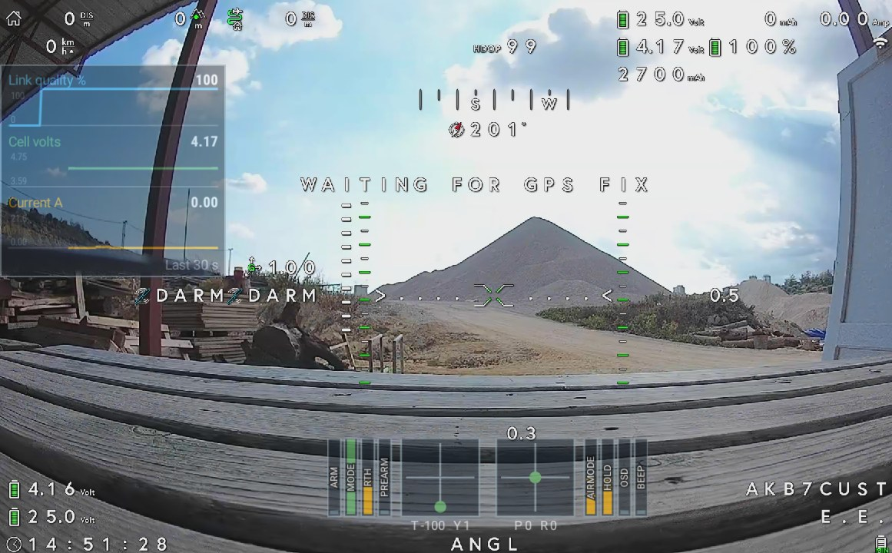

<p align="center"></p>

<p align="center"><b>English</b> · <a href="README.tr.md">Türkçe</a> · <a href="README.de.md">Deutsch</a> · <a href="README.zh.md">中文</a></p>

# AX-HUD: AX12 video monitor, HUD and announcer (v1.13.4)
> **Disclaimer:** AX-HUD is an independent open-source project and is NOT officially affiliated with, endorsed, or supported by RadioMaster. Use it at your own risk. The app only reads telemetry data and does not write to the radio's settings, but you are solely responsible for your equipment, configuration, and flight safety.
> **The RadioMaster SDK:** the release APK contains RadioMaster's AX SDK libraries. The SDK's repository states no licence, and RadioMaster has not answered my questions about redistribution. Read [the notice](#the-radiomaster-sdk-what-is-settled-and-what-is-not) before you use or share the APK.

**AX-HUD** is an Android app for the RadioMaster AX12:

* opens straight into **full-screen video** from the HDMI input;
* shows a gray **No video** screen (a camera icon, "No video" and one line of advice, with a small detail line along the bottom) when no frames arrive, and reconnects by itself;
* **speaks announcements** from rules you type, e.g. `ch5 >= 1500 -> drone armed`;
* announces **battery per cell, link quality, telemetry loss and the flight controller's flight mode**;
* has a second page, the **dashboard**: cards only and no video, with an artificial horizon, a compass, value cards, radar, charts and sticks, for goggles or a second pair of eyes;
* can **record every flight** to a CSV file (off by default) and **replay** it on the radio: radar, sticks, channel bars and charts, and a smooth **3D view** of the flight (new in 1.13);
* only **reads** from the radio. It never writes a setting.

## What's new

**1.13: the 3D flight replay (1.13.0 to 1.13.4)**

* **3D replay.** A replayed flight is drawn in 3D behind your cards: a speed-coloured ribbon over a flat ground with a horizon and a grid, the
  aircraft, a green HOME ring and flags at take-off, every flight-mode change, the end of the approval window, the farthest point, the highest
  point, the top speed and the landing. See [3D replay](#3d-replay).
* **Smooth motion.** The log holds a position and an attitude about once a second; the aircraft moves on a smooth curve through those points
  (frame-rate independent), so there are no steps and no corners.
* **Three cameras, two models.** Chase, Orbit (drag to turn, pinch to zoom) and Pilot; the aircraft can be drawn as a quad or as a plane.
* **The replay bar hides itself** after four seconds and comes back on any touch, so it no longer covers the sticks and the bottom cards.
* **Fixed (1.13.2):** the 3D model showed the pitch the wrong way (the log holds pitch positive with the nose down).
* **Easier to read (1.13.3, 1.13.4):** an arrow along the heading at the aircraft's own height, a triangle on the ground, a plane and a quad made of
  filled shapes, slightly bigger models and a higher chase camera.

**1.12: tabbed settings and honest logs (1.12.0 and 1.12.1)**

* **Settings in tabs with a search field** (1.12.0); the two Diagnostics groups were merged into one.
* **Fixed (1.12.1):** the three RSSI columns of a flight log were written as unsigned bytes (-201 instead of -55 dBm); the real log rate is
  reported; `win_left` is in minutes and negative after the window ends; the column descriptions were corrected. New: [Reading a flight log](#reading-a-flight-log).
* Community files: issue templates and `SECURITY.md`.

The full list is in [CHANGELOG.md](CHANGELOG.md).

## Install and first start

1. Download **`ax-hud.apk`** from the [latest release](../../releases/latest). (`ax-hud-plain.apk` is the same app without the serial-lock
   patch; it is for tests only. `SHA256SUMS` lets you check the download.)
2. Install it on the AX12 (allow installs from unknown sources when Android asks) and open it.
3. Allow the **camera** permission: the HDMI input reaches Android as a camera.
4. A short **welcome guide** explains the first steps. It can be shown again under *Settings > About > Show the welcome guide*.
5. The video starts at once. The radio data (sticks, link quality, telemetry) appears after about **12 seconds**; that wait is inside the
   RadioMaster SDK (see "Start-up time of the radio link"), and a banner counts the seconds.
6. Choose your aircraft and battery pack first (MENU > Aircraft, Battery): their limits drive the warnings.

The app looks for updates on the **Stable** channel by default (the tested releases). The Nightly channel is for people who want every build.

## Status

Built and tested by its author on one setup: **RadioMaster AX12 (Android 9, October 2026 system update), INAV 9.1, ExpressLRS**.
It works there: video, spoken announcements, warning bar, overlays, updates from GitHub. It has been checked that the
control link stays clean while the app starts, runs and is force-stopped. Other radios, firmware versions and flight
controllers are **untested**. The APK `ax-hud.apk` (with the serial-lock patch, see "Serial lock") is the one that works on the AX12.

| Part | State |
| --- | --- |
| Rules, text templates, warnings, CRSF parser, scaler, overlays, files, updater and translations (plain Java) | 2,312 automated checks pass |
| Native bridge core (C++, fake SDK, also under thread and address sanitizers) | 74 checks pass |
| Camera, layout, speech, JNI glue, Gradle/NDK build | built by CI, used on the radio |

## Languages

English, Turkish, German and Simplified Chinese: *Settings > Language* (Automatic follows Android). The voice can speak a
different language than the screen. German and Chinese have not been checked by native speakers yet; see
**[TRANSLATING.md](TRANSLATING.md)** to improve a text. A test estimates whether the translated texts fit their places (menu tiles,
the welcome guide, buttons); it is a safety net, not a measurement on the radio. Chinese uses a font that comes with the app (see "Chinese"), so it shows on every radio, even one with no Chinese system font (only if that
font cannot be loaded is the Chinese screen language skipped, because every text would show as empty boxes); if there is no voice for a
speech language, Settings says so.

## Quick navigation

In a hurry? Start with [installation](#install-and-first-start), then see the [flight screen](#flight-overlays-statistics-radar-and-pre-flight-checklist),
[menu and settings](#menu-and-settings), or [dashboard](#dashboard-a-second-page-with-cards-only). For deeper details, jump to
[flight logs and replay](#flight-logs-and-replay), [rules](#rules), [diagnostics](#diagnostics-and-bug-report),
[serial lock troubleshooting](#serial-lock-workaround), [build instructions](#build), or [privacy](#privacy).

## Screenshots



*In flight on the AX12 (the video and the OSD are the flight controller's; the cards on top are AX-HUD):*
**1** live charts of link quality, cell volts and current, **2** radar map with home, your track and range rings, **3** flight statistics,
**4** stick view with the aux channel bars, **5** the MENU button.



*The MENU (a photo of an earlier version, with six of today's nine tiles): large tiles with their state: speech on, the pack in use and the aircraft in use. The video
stays visible behind it. The amber bar along the top is the warning bar; each level has its own shape, here the diamond of a warning.*



*The pre-flight check (a photo of the radio's screen): the aircraft and the pack are named under the title, and every item must be ticked
before it says READY.*



*On the ground: the same screen before take-off, waiting for a GPS fix.*

## Flight overlays: statistics, radar and pre-flight checklist

**Settings > Overlays on the video > Flight overlays** switches each card on or off and sets its size, position (four corners or the
centre) and opacity.

* **Arm detection:** the arm switch (default channel 5, armed at 1750 us or more, disarmed below 1650, held 0.3 s)
  starts and stops a flight. The statistics start over when you arm and stay readable after you land. The cell count
  of the pack is set here too (for the lowest volts per cell).
* **Flight statistics card:** speed, **height above the arming point**, **current with a limit line**
  (the bar turns red above the limit; default 50 A) as *now / maximum*, plus optional rows: distance from home,
  lowest link quality, lowest volts per cell. A timer in the title shows the flight time; after landing it says
  LAST FLIGHT. Height comes from the GPS altitude relative to where you armed, so expect a few meters of error.
* **Radar:** home in the center, north up, three range rings, the track of the flight and the aircraft with its
  heading. It shows only positions relative to home, no coordinates. The scale grows as you fly farther and does not
  shrink during the flight.
* **Pre-flight checklist:** a card shown while disarmed with one row per check: green tick, red cross, or a gray dash
  when there is no value yet; READY or NOT READY at the bottom. The checks are **rules**, edited like the warnings
  (Settings > Overlays on the video > Flight overlays > *Edit the checks*): condition, thresholds, `and`/`or`, and a label that can hold live
  values such as `{sats}`. Defaults: battery connected, battery full (4.15 V per cell or more), 10 or more satellites,
  link quality 95 % or more, airmode switch on, arm switch off. The card is hidden when nothing is known yet.
  A small **X** in its top right corner closes it without arming; it comes back for the next flight (after you arm), or when you change
  the aircraft, the pack or the checks.

## OSD overlays: sticks, channel bars and the warning status bar

**Settings > Overlays on the video > OSD overlays** controls what is drawn over the video.

* **Stick view:** two boxes with a dot show roll, pitch, yaw and throttle from the channel values the radio sends.
  Size, position (five places) and opacity are settings. *Stick mode, channels and direction* sets the stick mode
  (1 to 4), which channel is roll/pitch/throttle/yaw (default 1, 2, 3, 4) and lets you reverse any stick axis.
* **Channel bars:** up to eight bars beside the sticks, four on each side (default channels 5 to 8 on the left,
  9 to 12 on the right). Each bar has an on/off switch, a channel number and a **name written along the bar**
  (defaults ARM, MODE, RTH, PREARM, AIRMODE, HOLD, OSD, BEEP, matching the AKB7's INAV modes; names up to 12
  characters). A bar fills with the channel value and its colour shows a switch position: gray-blue = low,
  amber = middle, green = high. A **reverse** box per bar is for a switch that is reversed in the radio: the bar then
  shows the switch the way you flip it (a reversed bar flips its fill and its colour). Only the picture changes;
  sound and warning rules still use the real channel values. Edit the bars in *Channel bars...* or **press and hold the
  stick view** on the video. One switch shows or hides the whole group.
* **Warning status bar:** one line at the top (or bottom) that lists every active warning, coloured by the worst:
  **critical = red and blinking, warning = amber, info = blue**. Warnings are **rules**, edited like the sound
  rules (Settings > Overlays on the video > OSD overlays > *Edit the warning rules*): pick variables from the list, thresholds, `and` / `or`,
  *Detect switch*, text. A warning is shown **while its condition is true** (a sound rule speaks once when it becomes
  true). Severity is part of the rule text: `!text` critical, `*text` info, `text` warning. A **timeout** (`@5` after the text, or
  the *Hide after* box in the editor) hides a warning N seconds after it turned on even if its condition stays true, for
  example `ch5 >= 1950 -> *ARMED @5`; it shows again the next time the condition turns on. A warning whose input
  disappears (for example the battery value when the aircraft is switched off) is removed instead of staying on
  screen. *Preview the warning bar* shows a sample for four seconds; each rule has a *Test* button.
* **Live values in texts**, for warnings and for spoken rules: `{vbat/6:2}` is volts per cell with two decimals,
  `{up_lq}`, `{sats}`, `{fm}`. A spoken rule such as `vbat / 6 < 3.6 -> battery {vbat/6:2} per cell` says the number.

## How the video is drawn, and measuring lag

The HDMI input is read with Camera2 into a `TextureView`: the frames go from the camera straight into a GPU texture
(hardware accelerated, no copies to the CPU, no bitmap or colour conversion). Rotation and stretch are a GPU matrix.
`TextureView` needs the app's main thread to put each new frame on screen and adds about one frame compared with a
`SurfaceView`, so main-thread work shows up as stutter. Most of the delay is in the radio's HDMI capture, before the app.
Settings > Diagnostics > Show variables prints the frame rate, the gaps between frames and how late the app's own
50 ms loop runs, so constant delay and stutter can be told apart.

## Menu and settings

The MENU button opens an in-screen panel (not a popup window: a popup takes the keyboard focus and Android then
shows its navigation buttons). Dialogs are shown full-screen safe in the same way. The MENU button hides itself and comes back for a few seconds whenever you touch the screen (Settings can keep it
always visible), and it hides while a panel is open so it never covers a panel's own buttons. The menu holds only the daily items: **Sound rules**, **Mute speech** and **Settings**.
**Settings** holds the rest: the MENU button option, video (camera, rotate, fit or fill), speech (on/off, test),
the sound rules files, and the diagnostics (variables panel, test channels).

**Export / import of the sound rules:** Settings > Rules and backup > Sound rules > *Export sound rules to a file...* opens Android's
file picker and saves a plain text file (`ax12-sound-rules.txt`, rules with one comment line on top). *Import* reads
such a file, shows how many rules it has and any problems, and replaces your rules only after you confirm. The old
rules are kept: *Restore the rules from before the last import* swaps them back (press again to swap forward).
On a device without a file picker the file is written to the app's own folder and its path is shown.

## Battery profiles (Li-ion / LiPo)

A **battery profile** is a kind of pack: its cell count and its volts-per-cell limits (low warning, critical, full). Two are
there from the start (Li-ion 6S: 3.70 / 3.55 / 4.15, LiPo 6S: 3.85 / 3.70 / 4.15); you can edit them and add more
(*Settings > Aircraft and battery > Battery*). **One tap on the MENU's Battery item switches the profile**; the app says its name aloud, shows the
limits, and the pre-flight checklist carries the profile's name in its title, so you can check it before every flight.

Rules, warnings and checks can use:

* **`cell`**: volts per cell (battery volts divided by the active profile's cells). It only exists while a pack is connected
  (at least 2.5 V per cell), so rules about it stay silent when the flight controller runs from USB.
* **`$low`, `$crit`, `$full`**: the active profile's limits, used instead of a number:
  `cell < $low and cell >= $crit -> battery low`. In the rule editor the **$** button next to the value inserts one.

Switching the profile changes the numbers, **not the rules**. Rules with plain numbers (`vbat / 6 < 3.70`) keep working
as before. The starting rules, warnings and checks use the new names; an existing install keeps its own text until you
*Reset the rules / warning rules / checks to the defaults* (Settings).

## Moving and resizing the cards

**Touch one spot of the video and hold it for 5 seconds** (a swipe, or any movement of the finger, cancels it; nothing happens while the aircraft is armed, over a panel or on the MENU button), or use *Settings > Overlays on the video > Layout of the cards > Move and resize the cards with your finger*, to open an edit mode over the video. The tick, or the back key, returns straight to the video. **Drag a card to
move it; drag the square handle at its bottom right corner to resize it.** The cards you can edit are the stick view, the flight
statistics, the radar, the pre-flight checklist and the live charts (switched-on ones; cards that are only shown at certain moments,
like the radar before a flight or the checklist while armed, are shown while you edit). A card snaps lightly to the screen edges and
can never leave the screen or grow bigger than it. A small see-through strip of icon buttons at the top centre (it hides as little as possible)
holds the **grid** button (a grid is drawn and a card's corner and size snap to 16 dp cells; on by default, the screen edges still win when a
card is close), the **reverse arrow** (*Reset the layout*: every card back in its corner) and the **tick** (done). On the dashboard the strip also has
**+** (add a card), **-** (remove a card) and a **pencil** (edit a value card). The **arrow at the right end** folds the strip to that one small
button and unfolds it again (the choice is remembered), and the strip steps aside by itself while you drag or resize a card. The back key also
finishes editing.

A card's place is stored as a fraction of the free space on the screen, so it stays where you meant it on any screen size; its size is
a factor on top of its *Size* setting (50 % to 250 %, as far as it fits the screen). A card you never touch stays in the corner chosen in
Settings. The layout is shared by all aircraft and is part of the full settings backup. The warning bar keeps its top/bottom setting.

## Live charts

*Settings > Overlays on the video > Flight overlays > Live charts* shows **up to four small graphs**, one per value, of the **last 30, 60 or 120 seconds**.
Each graph has its own scale, its name and unit, the value now, and the ends of its axis. Pick the values from the same list the rule
editor uses (*Charts: choose the values and the time window*); the default is link quality, volts per cell and current. Values with a
natural range keep a fixed scale (link quality is always 0 to 100, a channel 1000 to 2000), so a small wobble stays small; current, speed
and distance start at zero so the height of a punch means something; volts and the rest get a scale that never zooms in closer than a
sensible span. A missing value shows as a gap. Size, place and opacity work like the other cards. The charts start off (switch them on in
Settings) and fill as soon as the app runs.

Two new values come with them, usable in charts **and in rules**: **`height`** (meters above where you armed) and **`dist`** (meters from
home). They exist only while armed, so a rule like `height > 120 -> !above your approved height` (a ceiling warning) is silent on the ground.

## Dashboard: a second page with cards only

The **Dashboard** tile in the MENU switches to a second page with no video (and the camera rests); the same tile, now named **Video**,
switches back. The page you left is the page the app starts on. It is meant for pilots in goggles, who do not use the HDMI input, and for a
second pair of eyes beside the pilot. The warnings, the connecting banner and the MENU button stay on top of it, and a replay of a flight log
runs on it too.

* **Cards.** Horizon, compass, flight statistics, radar map, live charts, stick view and any number of **value cards**. The statistics,
  radar, charts and sticks are the same cards as on the video, and take their rows, channels and chart values from the same settings.
* **Horizon.** An artificial horizon from the pitch and roll angles of the flight controller (smoothed a little: telemetry arrives a few times
  a second). INAV counts a nose down pitch as positive, and the horizon follows that. Settings > Dashboard has *Horizon: invert pitch* and
  *invert roll* for a flight controller that does it the other way: tilt the aircraft nose down on the bench; the horizon should show more
  ground. The raw gyro rates are not sent in telemetry (only the blackbox has them), so the horizon shows angles, not rates.
* **Compass.** A rose that turns with the heading (the flight controller's yaw, or the GPS course when there is no yaw), the heading in
  degrees, and a green marker that points the way home, with the distance.
* **Value cards.** Pick any value (the same list as the rule editor), give it a label and a unit, choose the decimals, and set an amber
  and a red limit with the side that is bad (a battery gets worse downwards, a current upwards). A text value such as the flight mode is
  shown as text. The first dashboard has the cell volts, the current, the link quality and the flight mode.
* **Layout.** **Touch one spot of the dashboard and hold it for 5 seconds** (a swipe, or any movement of the finger, cancels it), or use Settings > Dashboard > *Edit the dashboard layout*, to open the same editor as the video cards (the tick, or the back key, returns straight to the dashboard; on the dashboard the hold works even in flight, because it hides no video): drag a card, drag its square
  handle to resize it, and use *Add a card*, *Remove a card* and *Edit a value card* in the bar. *Reset the dashboard layout* brings back the
  first dashboard. The layout is part of the settings backup.

  

*Example dashboard layout for a fixed-wing aircraft. It can also support instruction when a field monitor displays the HDMI video feed.*

## Flight logs and replay

**Settings > Flight logs** (off by default) writes a log of every flight, from arming to disarming (the arm switch you set under
*Arm detection*). One CSV file per flight, named like `AX-HUD_2026-11-07_14-55-33_Akb7custom001.csv`, in the app's own folder
`Android/data/dev.ax12.announcer/files/flights/` on the radio (no storage permission needed; copy it out over USB, or open it in a
spreadsheet). The top of the file lists the app, the aircraft, the pack, the cells and the arm switch; the last line is a summary.

* **Values.** *Values in the log* lists every channel and telemetry value the radio publishes (the same list as the rule editor), each with a
  tick box. Presets: *Replay set* (every standard value, the starting choice), *Everything* (adds the advanced ones) and *None*. The list
  warns when a replay would miss something (the arm channel, the sticks, position, speed, current, link, volts or a heading).
* **Rate.** 1, 2, 5, 10 (default) or 25 rows per second. About 10 MB an hour at 10 rows a second with the replay set.
* **Safe by design.** The log is written on its own thread. If the storage is slow the rows are dropped and counted (the last line says
  how many); if it fails, or less than 20 MB is free, logging stops and Settings says why. Nothing a log meets can reach the radio link or
  the screen. The file is flushed every second and closed when you disarm or leave the screen, and a file that was cut off is still
  readable. Only the newest 20, 50, 100 or 200 flights are kept (*Flights to keep*).
* **Flight list.** *Flight logs: list, replay and delete* shows each flight: date, aircraft, length, pack, highest point, farthest
  distance, top speed, peak current, lowest cell, mAh used. Each can be replayed or deleted; the flight being recorded is marked.
* **Replay.** The statistics, radar (with the track), stick view, channel bars and charts are drawn from the log by the same code that
  draws the live flight, over a dark backdrop with a red REPLAY tag (the video is not recorded). A bar at the bottom has Close, Play or
  Pause, the speed (1x, 2x, 4x, 8x), the camera and model buttons of the 3D view, a scrub bar and the time; it fades out after four seconds and
  comes back when you touch the screen. Seeking rebuilds the statistics and the chart from the start of the log, so
  they are right at any position. There is no voice and no warning bar in a replay, and arming the aircraft ends it at once.
  A card shows only what the log holds: with fewer values chosen, some cards stay empty (a toast names what is missing).
* **Privacy.** A log contains GPS positions. It stays on the radio unless you copy it. Do not publish a log that shows where you fly.


### 3D replay

When the log holds a position (a GPS fix with at least 6 satellites), the replay shows the flight in 3D behind the cards. The cards, charts and
scrub bar work as before; a log without a position shows a short note and the old replay.

* **What you see.** A ribbon coloured by speed (blue when slow, then green, yellow, orange, red above 110 km/h), a flat ground with a grid and a
  horizon, a green HOME ring where the log starts, thin drop lines to the ground (height at a glance), the aircraft, and flags: take-off, each
  flight-mode change, the end of the approval window, the farthest point, the highest point, the top speed and the landing. Flags never cover each
  other. An orange arrow at the aircraft's height and a triangle on the ground show which way the nose points.
* **Cameras.** One button on the replay bar: **Chase** (behind and above, follows with a delay; shows the last minute and the next 20 seconds),
  **Orbit** (drag to turn, pinch to zoom; the whole flight) and **Pilot** (fixed at home, the lens closes in as the aircraft goes away). A seek
  puts the camera at the new place at once.
* **Model.** Another button switches the aircraft between a **Quad** (long body, battery, camera, orange front arms, props) and a **Plane**
  (fuselage, wing with a red left and a green right tip, tail plane, fin, orange nose). The choice is remembered and is part of the settings backup.
* **Smooth motion.** The log changes about once a second, so the aircraft is moved on a smooth curve through the logged points (a cubic Hermite
  curve for the position, a quaternion curve for the attitude) and the view runs its own clock on every screen frame. It looks the same at 30 and
  60 frames a second. It cannot show what the log does not hold: a flip or a sharp turn shorter than a second is smoothed, and attitude and position
  come in separate packets up to a second apart. A faster telemetry ratio (1:16 or 1:8) gives a sharper replay.
* **Angles.** The log holds pitch positive with the **nose down** (fast flight reads +30 to +47 degrees), and the 3D view turns it. Yaw is the
  heading from the flight controller; roll is taken as positive with the right side down.
* **Limits.** Drawn with the canvas, not OpenGL (it is fast on the AX12); no event markers on the scrub bar yet; flag texts are in English.

### Reading a flight log

* **Rows.** Up to 20 per second, because the radio is polled every 50 ms. `rate_hz` in the header is the setting; `actual_rate_hz` in the
  last line is what the flight really got. The log ends with a line of totals that the app computed from the rows themselves.
* **How fresh the values are.** The channels (sticks and switches) change about 18 times a second. Everything the aircraft sends back (battery,
  current, GPS, attitude, vertical speed) changes only when the link sends it. With ExpressLRS at 150 Hz and a telemetry ratio of 1:32 that is
  about once a second, so most rows repeat the last value, and the battery voltage moves in steps of 0.1 V. Choosing more rows per second adds
  nothing; a faster telemetry ratio (1:16 or 1:8) gives a sharper log.
* **Signal.** `up_rssi1`, `up_rssi2` and `dn_rssi` are dBm (negative: -55 is strong, -90 is weak). `dbm` is the radio's own signal figure: a small
  positive number, not dBm, higher is stronger. `lost` is the radio's heartbeat: 0 means the receiver is lost, a steady number such as 5 means
  the link is alive. `tx_power` is in mW and drops by itself with dynamic power.
* **Logs from versions before 1.12.1** show the three RSSI columns wrongly, for example -201 for -55 dBm. The true value is the absolute value
  minus 256 (|-201| - 256 = -55 dBm).
* **`win_left`** is the minutes left in the approval window, negative once it has ended (minutes over), and empty before it opens or when it is
  off.
* **`pitch`, `roll`, `yaw`** are degrees from the flight controller's attitude. Pitch is positive with the nose down, yaw is the heading (-180 to 180).
* **`fm`** is the flight-mode text of the flight controller: `ANGL`, `ACRO`, `HOR`, `RTH` and so on. `OK` means disarmed and ready; `!ERR` means
  disarmed with arming disabled (for example the arm switch is still on after an automatic disarm).

## Around the flight: last position, approval window, packs and debrief

* **Last known position.** When the link is lost in flight (telemetry stops or the uplink quality is zero for 1.5 seconds, after the link had
  been good with a GPS fix), a card appears in the middle of the screen, on the video and on the dashboard: how long ago, the coordinates,
  the distance and bearing from home, height and speed. The voice says *Link lost, last position 412 meters south west of home, height 80
  meters*. The position is saved at once in `last_position.txt` in the app's folder on the radio (the folder of the flight logs, one level
  up), and refreshed every 5 seconds in flight, so it survives a restart. It stays on the screen until the link is back or you close it,
  also after you disarmed. *Settings > Landing, link loss and packs > Last known position* shows the file, copies the coordinates and opens
  them in a maps app when the radio has one.
* **Approval window.** *Settings > Approval window*: opens at, closes at (or *Two hours from now*), and the minutes at which to warn
  (default 30, 15, 10, 5, 2, 1). It repeats every day, may cross midnight and uses the clock of the radio (shown in the settings, so you can
  check it). A small chip under the MENU button shows the time left (yellow under 15 minutes, red under 5 and after the end). While the
  aircraft is armed the voice speaks each mark, speaks the end and repeats it every minute, and warns when you arm outside the window. The
  value `win_left` (minutes left) is available to value cards, charts, rules and logs.
* **Totals of a flight.** Distance flown (ground speed over time), energy (volts times amps over time) and capacity are added up from arming
  on and kept after landing. The values `flown_km`, `energy_wh`, `wh_km` and `mah_km` can be used in value cards, charts, rules and logs. The
  flight log footer holds `distance_km` and `energy_wh`, and the flight list shows distance, energy, Wh/km and mAh/km (for logs written
  before, they are worked out from the rows when the list opens).
* **Pack book.** Every flight of 20 seconds or more is added, when you land, to the pack that is selected: flights, flying time, mAh, Wh, km,
  efficiency, full charges (when the pack has a capacity), lowest cell and the last ten flights with the voltage the pack rested at four
  seconds after landing. *Settings > Landing, link loss and packs > Packs*. The book is part of the settings backup and does not depend on the
  flight logs.
* **Voice debrief.** Four seconds after landing: *Flight time 12 minutes 14 seconds. Distance 11.8 kilometers. Used 2918 milliamp hours.
  Efficiency 21.1 watt hours per kilometer. Lowest cell 3.40 volts. Resting cell 3.81 volts. Pack Li-ion 1, flight 4.* What is not known is
  left out. It has its own switch.

## Sunlight theme

In direct sun the glare lifts the black of an LCD, and light text on a dark background washes out. The **Sunlight theme** turns the
screens round: dark text on light backgrounds, nearly solid so that the video behind cannot spoil it. Switch it on with the **Sunlight
tile of the MENU** (a quick switch that shows the new look at once) or in *Settings > Display > Sunlight theme*; the choice is kept and is
part of the settings backup.

* **What changes:** the MENU, Settings, the sound, warning and check rules, About, the flight logs, the packs and the position pages, the
  welcome guide, the dialogs (also the clock dialog), and the **dashboard page** with all its cards (the horizon keeps its sky and ground and
  only gets a light frame).
* **Warnings get stronger:** in the status bar, on the video and on the dashboard, a critical warning is a saturated red, a warning a bright
  yellow with black text, information a deep blue; the bar has a thick outline, bigger bold text and thicker marks.
* **What does not change:** the cards over the video (statistics, radar, checklist, charts, sticks), the banners and the layout editor keep
  their look. The colours are checked by tests for contrast (text on its background at least 6 to 12 times as bright or dark as the
  background for the main text, at least 4.5 for the signal colours).

## Diagnostics and bug report

*Settings > Diagnostics > Diagnostics and bug report...* collects what a bug report needs, in one place:

* **A summary:** the version and build, the radio, the state of the radio link (connected after how many seconds) and the number of events.
* **The report:** versions, the device (Android, screen, memory, free space), the radio link with its **start-up timeline** and the last
  launches, the state of flight logging, a **digest of the settings** that tell how the app behaves, the **last events** of the session
  (the app started, the link came up or failed, the aircraft armed and disarmed, the link was lost and came back, an update check failed)
  and, after an unexpected stop, the **stack trace** of the crash. *Read the report* shows it before you send it.
* **What it never holds:** no GPS positions, no aircraft or pack names, no rules, no layouts and nothing personal. It is built from facts
  that carry none of these, and every line also passes a filter that takes out position pairs, long decimals, MAC and IP addresses,
  e-mail addresses and long numbers (also from your own note).
* **Buttons:** *Copy the report* (paste it into a GitHub issue), *Share the report...* (the radio's share sheet, when it has one),
  *Save the report to a file* (`bug_report.txt` in the app's folder), *Add a note...* (what you did and what happened), *Open the issue
  page* (or copies its address when the radio has no browser) and *Clear the events*.
* **After a crash** the page says so, shows the first lines of the record and lets you delete it. The record is a small text file; nothing
  is sent anywhere by the app.

## Fonts

Text is set in **Manrope** (four weights), titles and the big numbers in **Teko**, a narrow techno face; both are open fonts (SIL OFL 1.1),
bundled in `app/src/main/assets/fonts` and credited in About. They were chosen by measuring: Teko is the most condensed of the futuristic
fonts that have Turkish and German letters, so a number such as `126.4` takes little room on a card.

* **Teko has no fixed-width digits** (its 1 is narrow), so the numbers of the cards are drawn **digit by digit in slots of the same width**:
  a speed or a time never shifts sideways while it counts. The text font has fixed-width digits of its own.
* **A typography scale:** card titles in capitals (in the language of the screen: a Turkish i becomes İ), letter-spaced and medium weight;
  headings semi-bold; labels medium; body regular; page titles in Teko, a fifth bigger because Teko looks small.
* **No hunting through the code:** one routine gives every text of a screen its font by its role, after a screen or a dialog is built, so
  new screens follow the scale by themselves. Monospace text (the report, the rules text) stays monospace.
* **Buttons** (the rules and settings buttons, the rows you tap) take the shape style of the tiles; a plain Android button is a flat
  rectangle with a shadow that no cut corner can follow.
* **If the font files cannot be loaded** the system fonts stay and nothing breaks (an event in the diagnostics says so). Chinese still uses the
  radio's own font.

## Shapes

*Settings > Display > Shape* (tap to cycle) chooses the shape of cards, tiles and rows; it is kept and is part of the settings backup.

* **Chamfer, two corners (the default):** the top-left and bottom-right corners are cut at 45 degrees, as on aviation and sci-fi displays; it
  suits the narrow Teko numbers and costs the text no room.
* **Chamfer, four corners:** all four corners cut a little.
* **Corner brackets:** a quiet fill, a faint edge and bright accent brackets at the corners.
* **Soft corners:** rounded.
* **Plain rectangles:** sharp, as before.

It applies to the MENU tiles and box, the settings rows and headers, the cards of the dashboard and of the video (statistics, radar, charts,
checklist, compass, horizon, value cards), the banners and the warning bar. **Warnings keep a solid fill**: with brackets selected they are
cut at two corners instead, because brackets would leave them nearly empty. The stick boxes stay plain rectangles (they are measuring
displays), and so do the switches and the big text pages. The corner geometry is plain Java with tests; the style is read each time a view
draws, so a change shows at once.

## Antenna tracker

> **Experimental.** The antenna tracker is new. Its packets and geometry are tested on a PC, but the Bluetooth, servo, GPS and compass parts have
> had little testing on real hardware. Build it, try it away from people and with the antennas off first, and tell me what you see. Its
> Bluetooth link has no pairing or encryption (see [SECURITY.md](SECURITY.md)).

AX-HUD can drive an **antenna tracker**: an ESP32 with two servos (pan and tilt), its own GPS and a compass, that points your antennas (wide patch
antennas are forgiving) at the aircraft. The firmware, the wiring and the build instructions are in **[tracker/README.md](tracker/README.md)**.

* **How it works.** The radio sends the aircraft's state over **Bluetooth LE** five times a second: position, speed, course, height above the
  launch point and how old the position is. The tracker knows its own position (GPS) and the direction its base faces (compass), works out the
  bearing and elevation, moves the position forward with the aircraft's speed and course (the telemetry of ExpressLRS can be seconds old), and points
  the servos. With a tilt that goes past vertical, two ordinary 180-degree servos cover every direction.
* **In the app:** *Settings > Antenna tracker*: use it, find the tracker (a search, once; Android asks for the location permission for it, AX-HUD does
  not read the location), follow or hold, centre, a 30-second test sweep, compass calibration, the magnetic declination and the antenna height.
  A chosen tracker is connected by its address and reconnected if the link drops.
* **Tested on a PC:** the packets (the app and the firmware read the same file of packets, `tracker/test/vectors.txt`) and the geometry. **Not yet
  tested on hardware:** the Bluetooth, servo, GPS and compass parts; please report what you see in the diagnostics events named "tracker".

## Splash screen

The start-up splash is drawn and animated in one view (about 2.9 seconds; a tap or Back skips it; *Settings > Display* can switch it off). The
frame around the logo draws itself along its cut-corner outline, two corner brackets close it, the logo grows in under a passing light, a
tag slides in, the title **AX-HUD** appears letter by letter in Teko and catches a light that runs across the letters only, a line draws
under it, the tagline follows, and the version chip draws itself last. The timing is plain Java with tests (`SplashTimeline`); the
animation reads nothing from the radio and the app starts up behind it, so it costs no waiting. Android's own start-up screen already
shows the same navy, so there is no white flash before it.

## Chinese

Some radios, the AX12 among them, ship without a Chinese system font, and every Chinese text would show as empty boxes. The app therefore
carries **Noto Sans SC** (SIL OFL), cut down to the 733 characters its Chinese texts use plus the usual punctuation (two weights, 207 KB
each), and uses it for all text when the language is Chinese. Chinese can now be chosen on every radio, in *Settings > Language* (it comes
after German). Numbers stay in Teko. A test checks that every character of the Chinese texts is in the font, so a text added later cannot
silently show as a box. When you add a Chinese text, run `python3 tools/make_fonts.py` (it needs `pip install fonttools brotli`) and the
font files are rebuilt with every character of the Chinese texts; then run the tests.

## Start-up time of the radio link

**Why the sticks take about 12 seconds to move after the app starts.** Measured on an AX12 with the logcat of both apps: the SDK's own
serial-port start-up takes a fixed ~12 s (11 of 12 recorded launches took 11.9 to 12.2 s from the SDK's first port scan to the port
opening), and the first channel data arrives 24 ms after the port opens. AX-HUD's own part is about 1 s (the SDK call takes 22 ms).
RadioMaster's stock app is told its serial ports up front (`ttyS0` and `ttyS4` at 921600 baud) and opens the port 4.4 s after it starts.
The public SDK has no way to pass a port: `initialize()` only takes a data folder, it exports no other function for it, and
`postMessage()` is not meant for it. So this time cannot be shortened from the app; it needs an SDK change by RadioMaster. (The
"denied" lines in logcat are harmless: this radio runs SELinux in permissive mode.)

**What the app does about it**

* The radio link is started on a **background thread**, as RadioMaster's demo does (the device information is requested first and again
  when the configuration is loaded; the configuration is asked for again only after 6 s), so the screen and the camera are not held up.
  While it starts no data and no pretend data is shown.
* **The link stays up as long as any screen of the app is on show.** That includes the text editor for the sound, warning and check
  rules, which is a separate screen: it no longer stops the link, however long you edit, and nothing has to be started again
  (about 12 s without stick data) when you come back. The link is released only when the app has left the display (Home, another
  app, screen off, or the app closed), and then at once, so the radio's serial port is free for the stock app.
* **Rebuilds and file pickers.** A rebuild (changing language or aircraft, importing settings) and the screens other apps provide
  (the file pickers, the browser link) take the whole app off the display for a moment. The link is then kept for 10 s after a
  rebuild and 40 s after a picker or the browser, and released only if the app does not come back in that time.

**Timings.** *Settings > Diagnostics > Show the variables panel* starts with a timeline, in milliseconds since the app's process started:
the screen created, the SDK start called, `initialize()` returned, the message callback set, each time the configuration was requested,
the first channel message (mixout), the device information answered, the configuration loaded, the channel list available, and the first
sample in the app that can move the sticks. The same lines go to logcat under the tag `ax12timing` (`adb logcat -s ax12timing`).
*Show the start-up timings of the last launches* keeps one line for each of the last 10 launches
(`start | call took | init done | mixout | config | requests | graph`); `graph` is the time until the first stick value reached the
screen. If you capture logcat with PowerShell's `>`, the file is UTF-16; use `| Out-File -Encoding utf8` to get UTF-8.

## Looks: shapes, fonts, see-through panels, icons

* **Shapes.** Cards, tiles, rows, buttons and the warning bar take the shape style chosen in *Settings > Display > Shape* (see "Shapes"):
  two cut corners by default, or four cut corners, corner brackets, soft corners or plain rectangles. The stick boxes, the switches (a
  square thumb in a square track), the layout editor's frames and the big text pages stay plain rectangles. The radar is a square card;
  only its range rings stay round.
* **Settings rows: label and value.** A setting that cycles through values is one row: the label on the left, the value on the right
  in blue ("Size ... Medium"), instead of "Size: Medium (tap to change)". Rows are at least 48 dp tall, and long labels wrap, so German
  and Turkish fit.
* **The MENU is a grid of nine large square tiles** (two rows: Sound rules, Speech, Battery, Aircraft and Sunlight in the first; Dashboard or Video, Flight logs, Settings and Exit in the second), each
  with an icon, a name and, where there is something to show, its state: Speech shows On or Off, Battery the pack in use, Aircraft the
  aircraft in use, in words and in a coloured bar along the bottom (green On, red Off, blue for the pack and aircraft). Speech and
  Battery keep the menu open when tapped, so the new state can be seen at once.
* **Connecting banner.** While the radio link comes up (the SDK needs about 12 s) a card at the top says "Connecting to the radio...
  7 s" and shows a strip that fills towards 12 s; after 20 s it says what to check (close the RadioMaster app, check that the radio is
  on). It goes when the radio answers.
* **HUD numbers** are set in Teko, a narrow bold face, drawn digit by digit in slots of equal width, so values do not jitter and take less
  room (see "Fonts").
* **Warning bar.** A thicker bar (48 dp) with a shape in front of the text, so it does not depend on colour alone: a triangle for
  critical, a diamond for warning, a circle for info. A critical warning breathes slowly (70 % to full) instead of blinking.
* **No-video screen.** A big camera-off icon, "No video", and one line saying what is wrong or what to check; the technical line stays
  small along the bottom.
* **Touch targets and spacing.** Everything you tap is at least 48 dp; spaces and sizes follow a 4/8 dp grid (a test checks the new
  screens). **Long text:** buttons wrap to two lines and then shrink (down to 11 sp) instead of being cut off; tiles, group headers
  and the warning bar do the same (Android 8 and newer, which is what the AX12 runs).
* **One motion rule.** Every fade and slide takes 150 to 250 ms (220 in, 160 out). Panels slide in from the right edge, the menu from
  the top, cards fade; a test checks that no animation uses its own time.
* **See-through menu and panels.** The MENU box and the backdrop of Settings, About and the rules let the video show through, so you
  can see that it is there while you change a setting. Rows, notes and text sit on darker blocks, so they stay readable over moving video.
  Dialogs stay nearly solid, because you type in them.
* **Exit.** The MENU ends with an **Exit** item (in a warning colour, below a divider). It asks first, then closes the app, removes it
  from the recent apps and releases the radio's serial port.
* **One look everywhere.** Every card (sticks, statistics, radar, checklist, charts) shares the same background, edge and colours, and
  so do the menu and the panels. Buttons take the shape style of the tiles, dialog buttons are written like every other button (not in capitals), and
  every dialog is dark with light blue buttons.
* **Capitals and spelling.** Every text starts with a capital letter (option values, column headings, error lines, hints, captions);
  no text is half in capitals and half not; one spelling (American) everywhere; one product name and one tagline on the splash and the
  About page. The all-capitals HUD labels (SPEED, READY, ...) are on purpose. A test checks all of this, in English, German and Turkish.
* **Settings are tabs, with a search.** *Settings* has a rail of eight tabs on the left (General, Aircraft and flight, Video and overlays,
  Dashboard, Antenna tracker, Flight logs, Rules and backup, System) and the rows of the open tab on the right. The search field in the
  title bar finds a setting by its words in every tab: capitals and accents do not matter ("istatistik" finds "İstatistik"), every word has to
  be in the label, and the results are the real rows, listed under their tab and heading, so a switch works right there. Tapping a tab
  clears the search. General opens first, and its first heading is written in four languages on purpose, so the language can always be found.
  The two Diagnostics groups of earlier versions are one section of System.
* **Icons** in the MENU and in the Settings groups. They are described in a small text file (`app/src/main/assets/icons.txt`), so they
  can be changed or extended without touching the code.
* **Soft fades.** Cards fade in and out instead of popping; the MENU fades in.
* **About page** (*Settings > About > About AX-HUD, licenses and thanks*): the license of the app, a link to the project, and every
  library and SDK inside the app with its license text, readable offline.

## Aircraft profiles and packs

Each aircraft can have its own setup. *Settings > Aircraft and battery > Aircraft* (and the MENU's **Aircraft** item) switch between them; *Manage the
aircraft* adds one (a copy of the current setup, or the starting settings), renames and deletes.

* **Per aircraft:** sound rules, warning rules, pre-flight checks, battery profiles and packs, aux channel bars (names),
  stick mapping, arm switch and current limit.
* **Shared by all:** overlay looks and places, language, speech language, camera and video settings, updates.
* Switching saves what you changed on the aircraft you leave and loads the other one; nothing is lost on the way. The screens are
  rebuilt for a moment. Your existing setup becomes the first aircraft, "My aircraft".
* The pre-flight checklist shows the aircraft and the pack under its title, so you see before arming that the right setup is loaded.
* The **full settings backup includes every aircraft**.

**Packs** are the named packs of an aircraft (*Settings > Aircraft and battery > Battery > Edit the packs*): a name, the battery profile it uses and its
capacity (for your records). With packs, the MENU's Battery item chooses the **pack** and the pack chooses the profile (Li-ion or
LiPo limits); the voice says the pack's name. With no packs it switches the profile directly, as before.

## Backup of all settings

*Settings > Rules and backup > Backup of all settings* writes **one text file with everything**: sound rules, warning rules, pre-flight checks,
overlays and their places, stick and channel-bar settings, arm detection, battery profiles, camera, language and update
channel. *Import* shows what the file contains, replaces the settings in it, and keeps the old ones: *Restore* swaps them
back (press again to swap forward). Only known settings with valid values are read, so a damaged or hand-edited file cannot
break the app. The sound rules also keep their own, smaller export. The file is a complete snapshot, so it is also the way to
move the setup to another radio.

## Rules

**MENU > Sound rules** opens a list you can tap: switch a rule on or off, **Edit**, **Test** (speaks it), **X** (delete),
**+ Add rule**. In the editor press **List** to pick a channel or telemetry value from a grouped list with live values (or type a name), then pick an operator and a value, type what to say, and press
**Detect switch** then move a switch on the radio: the channel and a sensible threshold are filled in for you. The
editor shows the live value of each variable ("now: 1500") and the rule as text. **Settings** holds the hysteresis,
hold time, start-up behaviour and unit. The GUI and the text editor edit the same text, so they always agree;
comments and settings in the text are kept. A switched-off rule is stored as a comment starting with `#off`.
Rules the GUI cannot show (mixed `and`/`or`) appear as "Advanced rule" and open the text editor.

**Settings > Rules and backup > Edit the rules as text (advanced)** edits the same rules as plain text, one rule per line:

```
ch5 >= 1500 -> drone armed | drone disarmed          text after | is spoken when it turns false
ch6 >= 1450 and ch6 <= 1550 -> horizon mode          and / or ("and" binds first)
vbat / 6 < 3.55 -> !battery critical @10             divide first (volts per cell); ! urgent; @10 repeat every 10 s
fm ~ "RTH" -> return to home active                  text rules:  ==  !=  ~ (contains), case-insensitive
hysteresis = 25   var_hysteresis = 1   hold = 100   initial = off   scale = auto
```

* A rule speaks when its condition **becomes true**, not while it stays true (unless `@N`).
* `hysteresis` (channel units) and `var_hysteresis` (percent, for volts and link quality) stop chatter.
* `hold` ignores changes shorter than that many ms. The first reading is silent unless `initial = on`.
* A rule whose variable has no value is skipped (for example battery rules before telemetry arrives).
* `scale` is the unit of the radio's channel numbers. The SDK does not name it, so `auto` guesses from the
  numbers seen (percent, then permille, then microseconds). Look at Settings > Diagnostics > Show variables.

### Variables (Settings > Diagnostics > Show variables lists the live ones)

| Name | Meaning |
| --- | --- |
| `ch1`..`ch16` | channel output in microseconds (1000..2000) |
| `raw1`..`raw16`, `lv1`..`lv16` | the radio's own numbers: `chOut` and `logicVal` |
| `lq`, `dbm`, `lost`, `txv`, `rxv`, `tlm` | radio status: link quality, dBm, lost counter, radio voltage, receiver voltage, telemetry present (1/0) |
| `vbat`, `curr`, `capa`, `batpct` | battery from the flight controller (CRSF 0x08) |
| `up_lq`, `up_rssi1`, `up_rssi2`, `up_snr`, `dn_lq`, `dn_rssi`, `dn_snr`, `rf_mode`, `tx_power` | link statistics (CRSF 0x14) |
| `fm` (text) | flight mode name (CRSF 0x21) |
| `gps_lat`, `gps_lon`, `gps_speed`, `gps_heading`, `gps_alt`, `sats` | GPS (CRSF 0x02) |
| `pitch`, `roll`, `yaw`, `vspeed` | attitude and vertical speed |

CRSF values older than 5 s are dropped, so a rule never acts on a stale reading.

## Build

The RadioMaster SDK files are **not stored in this repository** (the SDK repository states no licence of its own).
The CI workflow clones <https://github.com/Radiomaster-RC/RadiomasterAX_SDK>, checks out the commit `7aa7fac` (pinned in `.github/workflows/build.yml`, so that a change on their side cannot break the build or change what is shipped) and copies the five `.so` files into
`app/src/main/jniLibs/arm64-v8a/` and the headers into `app/src/main/cpp/sdk-include/rmAxSdk1/` before building.
Without those files the app still builds and runs on the test sliders.

Locally: JDK 17, Android SDK + NDK, `gradle :app:assembleDebug` (copy the SDK files in first, same folders).

## Serial lock workaround

The SDK talks to the radio over a serial link that Qt's `QSerialPort` opens only after creating a lock file. An Android app has no writable lock directory, so the link may never open: then the Show variables panel says `radio config: NOT loaded yet` and `mixout msgs` stays 0.

* The app always points Qt's temp folder (`TMPDIR`) at its own data folder before the SDK starts (as RadioMaster's demo does).
* To bypass the QSerialPort lock file requirement on Android, the app applies a memory patch similar to the official demo. The patch is in **`ax-hud.apk`**, which the CI builds with the Gradle flag `-PaxLockPatch=true`; **`ax-hud-plain.apk`** is the same app without it. It checks both instructions are exactly the expected ones before changing anything.
* Close RadioMaster's own AX app first: two programs must not read the same serial port.
* Look for the cause in `adb logcat`: lines with `qt`, `serial`, `lock` or `ax12bridge` ("Failed to create a lock file").
* The proper fix is an official way from RadioMaster to open the link; please ask them.
## Try it without the radio

Settings > Diagnostics > Test channels shows 16 sliders (1000..2000 us). Move ch5 above 1500 and listen.

## Tests

```
mkdir -p out
javac -d out app/src/main/java/dev/ax12/announcer/*.java app/src/test/java/dev/ax12/announcer/*.java
for t in RuleEngineTest ExtraTests RuleTextTests RulesFileTests TimingStatsTests OverlayTests AuxBarsTests FlightTests UpdateTests BatteryTests SettingsFileTests AircraftTests ChartTests LayoutTests AboutTests StartupTests SdkThreadTests AppVisibilityTests LookTests PolishTests LicenseTests FirstRunTests LanguageFitTests CheckCardTests LogFormatTests FlightLoggerTests LogStoreTests ReplayTests LogTextTests DashboardTests PositionTests WindowTests PackTests SunlightTests DiagTests FontTests ShapeTests SplashTests I18nTests; do
  java -cp out dev.ax12.announcer.$t
done
# native core (needs the SDK headers in sdk-src/include/rmAxSdk1):
g++ -std=c++20 -pthread -Iapp/src/main/cpp -Isdk-src/include/rmAxSdk1 app/src/test/cpp/bridge_core_test.cpp app/src/main/cpp/bridge_core.cpp -o bridge_test && ./bridge_test
```

## Privacy

Permissions: the **camera** (the HDMI input reaches Android as a camera), **internet** and **install packages** (only for the update check and
the update you ask for), and, on Android 9 and older, **storage read and write**, used only to save a screenshot (triple tap on the top edge)
to `Pictures/AX-HUD`; Android 9 lists them as two switches and the app asks for both. For the **antenna tracker**: Bluetooth, and the location permission,
asked once and only to search for the tracker (Android requires it for Bluetooth searches; the app does not read the location). If a screenshot cannot be saved, *Settings > Diagnostics*
shows why in the events.

GPS coordinates are shown on screen. When a GPS fix is available, the app also saves the last known position to `last_position.txt` in its app folder, including during flight and when the link is lost; this is independent of flight logging. If you enable flight logs (off by default), those CSV files can also contain GPS positions. Three taps on the top edge (away from MENU) save a full-screen PNG, including any visible coordinates, to `Pictures/AX-HUD`. These files stay on the radio unless you copy them elsewhere. Do not commit flight logs or screenshots that show where you fly.

## Updates from GitHub

**Settings > Updates > Check for updates now** looks on GitHub for a newer build, downloads it, checks its SHA-256, and
hands it to Android's installer, which asks you to confirm. Two channels: **Nightly** (the newest build, published by CI on every push to `main`, versions like `1.10.1-nightly.45`) and
**Stable**, the default (the latest GitHub release, made with one click from the Actions tab or by pushing a tag such as `v1.10.1`). The app can
also look for news a few seconds after it starts (switchable). Every build is signed with **one permanent key** kept in GitHub
secrets, which is what lets each build install over the last one without uninstalling. The one-time setup, the daily routine and
the error messages are in **[UPDATES.md](UPDATES.md)**. The only network use is fetching two files from github.com; the app has
the internet permission for that and nothing else.

## Logo

`docs/logo.png` (512 px) and `docs/logo-768.png` are the AX-HUD logo: a flat navy rounded square with the radio, the
drone, the gauge and the name. The launcher icons are built from it. Android 8 and newer (the AX12 runs Android 9) use
an adaptive icon: navy background and the artwork as the foreground, kept inside the safe zone so every launcher shape
shows it whole. Older Android versions get the full design. The logo has no third-party logos in it, and every edge is
pure navy (no light fringe).

## The RadioMaster SDK: what is settled and what is not

AX-HUD reads the radio's channels and telemetry through the **AX SDK that RadioMaster publishes**
(<https://github.com/Radiomaster-RC/RadiomasterAX_SDK>). The release APK contains the SDK's libraries, unchanged, from the commit pinned in
`.github/workflows/build.yml`; the SDK files are not stored in this repository.

* **What points to permission.** The SDK is published for app developers, and its manual tells integrators to put the libraries into their
  app's `jniLibs` folder.
* **What is not written down.** The SDK repository has no licence file, so its terms for using and redistributing the libraries are not
  stated. The Qt libraries inside it are LGPL, and their licence text is in the app (About).
* **What I did.** I asked RadioMaster in November 2026, first through their support (the ticket was closed without a reply) and then in an
  issue on the SDK repository. I have had no answer so far, so I am publishing the app with this notice instead of waiting.
* **What I will do if someone objects.** If RadioMaster or the authors of the SDK state terms or ask me to stop, I will remove the libraries
  from the releases promptly and offer a way to build the app without them (you would add the SDK yourself, as described in "Build").
* **The licence of AX-HUD's own code.** GPL-3.0-or-later, with an added permission in [LICENSE](LICENSE). That permission is mine to give
  for my own code; it gives you no rights in RadioMaster's files.

This is not legal advice. If you want to redistribute the APK, decide for yourself, and ask RadioMaster if you need certainty.

## Acknowledgments

Thanks to **RadioMaster** for publishing the AX SDK that makes this app possible. AX-HUD is an independent project and is not
affiliated with RadioMaster. The app also includes the Qt libraries that come with the SDK (LGPL).

## License

AX-HUD is free software under the **GNU General Public License, version 3 or later** (GPL-3.0-or-later), with an **additional permission**
that allows it to be combined with RadioMaster's AX SDK (see [LICENSE](LICENSE)). In short: you may use, study, change and share it;
if you share a changed version, or a program built on it, you must share the source code under the same license.

* **Other terms.** The copyright holder can grant a separate written license on other terms to a particular party. Nobody else can: without
  such an agreement, the GPL applies to everyone.
* **Components.** The RadioMaster SDK, the Qt libraries and the other components that are inside the APK keep their own licenses; they are
  listed, with links and the full texts, in [THIRD_PARTY_NOTICES.md](THIRD_PARTY_NOTICES.md) and in the app under *Settings > About > About
  AX-HUD, licenses and thanks*.
* **Contributions.** See [CONTRIBUTING.md](CONTRIBUTING.md): a contribution needs a short contributor agreement, so that the project can
  keep licensing consistent.
* **Name.** "AX-HUD" and the logo are the maintainer's; a changed version should use another name.
