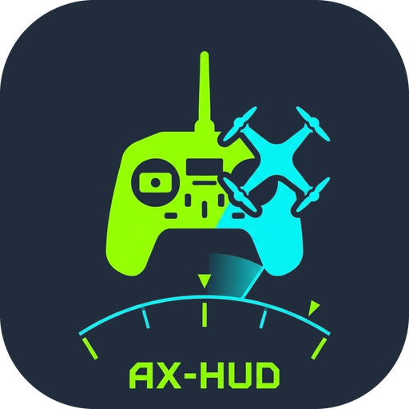

<a href="README.md">English</a> · <b>Türkçe</b> · <a href="README.de.md">Deutsch</a> · <a href="README.zh.md">中文</a>

# AX-HUD: AX12 video monitörü, HUD ve sesli uyarı

> **Sorumluluk reddi:** AX-HUD bağımsız, açık kaynaklı bir projedir; RadioMaster ile resmî bir bağlantısı yoktur ve RadioMaster tarafından onaylanmaz veya desteklenmez. Kullanım kendi sorumluluğunuzdadır. Uygulama telemetri verilerini yalnızca okur, kumanda ayarlarına yazmaz; ancak ekipmanınız, yapılandırmanız ve uçuş güvenliğinizden yalnızca siz sorumlusunuz.

> **RadioMaster SDK'sı hakkında:** Yayın APK'sı RadioMaster'ın AX SDK kütüphanelerini içerir. SDK deposunda lisans dosyası yoktur, yeniden dağıtım koşulları yazılı değildir; RadioMaster'a Kasım 2026'da önce destek kaydıyla, sonra SDK deposunda bir konuyla sordum ve henüz yanıt almadım. RadioMaster veya SDK'nın yazarları koşul belirtir ya da durdurmamı isterse kütüphaneleri sürümlerden hemen kaldıracağım. Ayrıntılar (İngilizce): [README.md](README.md#the-radiomaster-sdk-what-is-settled-and-what-is-not). Hukuki tavsiye değildir.

**AX-HUD**, RadioMaster AX12 için bir Android uygulamasıdır. Kumandadan yalnızca **okur**, hiçbir ayar yazmaz.

## Ne yapar?

* HDMI girişinden gelen videoyu **tam ekran** gösterir; görüntü yokken altta ince bir durum çubuğu çıkar ve kendiliğinden yeniden bağlanır.
* Yazdığınız kurallarla **sesli uyarı** verir. Örnek: `ch5 >= 1500 -> motorlar aktif`. Kurallar uygulama içinden düzenlenir: eşikler, `and`/`or` mantığı, anahtar algılama, `{vbat/6:2}` gibi canlı değerler.
* Kurallarla aynı mantıkta çalışan bir **uyarı durum çubuğu** gösterir (kritik = kırmızı ve yanıp söner, uyarı = sarı, bilgi = mavi; istenirse N saniye sonra gizlenir).
* **Ekran katmanları:** stick görünümü ve aux anahtar çubukları (adları değiştirilebilir, ters çevrilebilir), uçuş istatistikleri (en yüksek hız, en yüksek irtifa, tepe akım), radar ve uçuş öncesi kontrol listesi.
* **Menü:** Ses kuralları, Konuşma, Pil, Hava aracı ve Güneş ışığı ilk sırada; Pano/Video, Uçuş kayıtları, Ayarlar ve Çıkış ikinci sırada olmak üzere dokuz kutucuk.
* **Uçuş kayıtları ve tekrar:** her uçuş CSV dosyasına kaydedilir (varsayılan kapalı) ve kumandada tekrar izlenir: radar, stickler, kanal çubukları, grafikler ve uçuşun akıcı bir **3D görünümü** (1.13 ile yeni).
* **GitHub'dan güncelleme:** Ayarlar > Güncellemeler. İki kanal: Nightly (her push) ve Stable (sürümler). Ayrıntılar: [UPDATES.md](UPDATES.md).
* **Dil:** İngilizce, Türkçe, Almanca, Çince. Ayarlar > Dil. Ses, ekrandan farklı bir dilde konuşabilir.

## Yenilikler

**1.13: 3D uçuş tekrarı (1.13.0 – 1.13.4)**

* **3D tekrar.** Kaydedilmiş bir uçuş kartların arkasında 3D olarak çizilir: hıza göre renklenen bir şerit, ufuk çizgili düz zemin ve ızgara, hava aracı,
  yeşil HOME halkası ve kalkış, her uçuş modu değişimi, onay penceresinin bitişi, en uzak nokta, en yüksek nokta, en yüksek hız ve iniş için bayraklar.
* **Akıcı hareket.** Kayıtta konum ve yönelim yaklaşık saniyede bir değişir; hava aracı bu noktalardan geçen yumuşak bir eğri üzerinde hareket eder
  (ekran hızından bağımsız), basamak ve köşe görülmez.
* **Üç kamera, iki model.** Takip, Yörünge (kaydırarak döndürün, iki parmakla yakınlaştırın) ve Pilot; hava aracı quad veya uçak olarak çizilebilir.
* **Tekrar çubuğu kendiliğinden gizlenir:** dört saniye sonra solar, ekrana dokununca geri gelir; böylece stickleri ve alttaki kartları kapatmaz.
* **Düzeltme (1.13.2):** 3D model eğimi (pitch) ters gösteriyordu; kayıtta pitch burun aşağıyken pozitiftir.
* **Okunması kolaylaştı (1.13.3, 1.13.4):** yönü gösteren ok ve yerde bir üçgen, dolu şekillerle çizilmiş uçak ve quad, biraz büyük modeller, daha yüksek takip kamerası.

**1.12: sekmeli ayarlar ve doğru kayıtlar (1.12.0 ve 1.12.1)**

* **Ayarlar sekmeli ve arama alanlı** (1.12.0); iki Tanılama grubu birleştirildi.
* **Düzeltme (1.12.1):** uçuş kaydındaki üç RSSI sütunu işaretsiz bayt olarak yazılıyordu (-55 dBm yerine -201); gerçek kayıt hızı bildirilir; `win_left` dakika
  cinsindendir ve pencere bittikten sonra negatiftir; sütun açıklamaları düzeltildi.
* Topluluk dosyaları: sorun şablonları ve `SECURITY.md`.

Tam liste: [CHANGELOG.md](CHANGELOG.md). 3D tekrarın ayrıntıları için [İngilizce README](README.md#3d-replay) dosyasına bakın.

## Gereksinimler ve kurulum

* RadioMaster **AX12** (Android 9). Yazarın denediği düzen: Ekim 2026 sistem güncellemesi, INAV 9.1, ExpressLRS. Diğer düzenler **denenmedi**.
* **Releases** sayfasından `ax-hud.apk` dosyasını indirin (seri kilit yamalı olan; AX12'de çalışan budur) ve kurun.
* AX12'nin kendi RadioMasterAX uygulamasını **kapatın**: seri portu aynı anda yalnızca bir uygulama kullanabilir. AX-HUD kapanınca port geri verilir.

## Seri port kilidi geçici çözümü

SDK, Qt'nin `QSerialPort` bileşeni üzerinden seri porta erişirken bir kilit dosyası oluşturmak ister. Android uygulamasının yazma izni olan bir kilit dizini bulunmadığında bağlantı açılamayabilir; Değişkenleri göster panelinde `radio config: NOT loaded yet` görünür ve `mixout msgs` değeri 0 kalır.

* SDK başlamadan önce uygulama, Qt'nin geçici dosya dizinini (`TMPDIR`) kendi veri klasörüne ayarlar.
* Android'de `QSerialPort` kilit dosyası gereksinimini aşmak için uygulama, resmî demodakine benzer bir bellek yaması kullanır. Yama `ax-hud.apk` içindedir (CI bunu `-PaxLockPatch=true` ile derler); `ax-hud-plain.apk` aynı uygulamadır ama yamasızdır. Yama yalnızca beklenen iki makine talimatı doğrulandığında uygulanır.
* AX12'nin RadioMaster uygulamasını kapatın; seri portu aynı anda iki uygulama kullanmamalıdır.
* Sorunu araştırmak için `adb logcat` çıktısında `qt`, `serial`, `lock` veya `ax12bridge` ifadelerini ve `Failed to create a lock file` iletisini arayın.
* Kalıcı çözüm, RadioMaster'ın seri bağlantıyı açmak için resmî bir yöntem sunmasıdır; bu desteği RadioMaster'dan isteyin.

## Güvenlik

Bu uygulama deneyseldir ve **yedek bir bilgi kaynağı** olarak kullanılmalıdır; uçuş kontrolcünüzün OSD'sinin yerini tutmaz. Kullanım kendi sorumluluğunuzdadır. Bulunduğunuz yerin kurallarına uygun uçun. Uçuş sırasında güncelleme yapmayın.

## Gizlilik

Uygulama güncellemeleri almak için github.com'a bağlanır; başka bir yere veri göndermez. GPS konumu bulunduğunda, uçuş sırasında ve bağlantı kaybında da son bilinen konum kumandanın uygulama klasöründeki `last_position.txt` dosyasına kaydedilir; bu, uçuş kayıtlarından bağımsızdır. Uçuş kayıtlarını açarsanız (varsayılan olarak kapalı), CSV dosyaları da GPS konumu içerebilir. MENU düğmesinden uzakta, ekranın üst kenarına üç kez dokunmak, görünen koordinatlar dâhil tam ekran bir PNG'yi `Pictures/AX-HUD` klasörüne kaydeder. Bu dosyalar başka yere kopyalamadıkça kumandada kalır. Uçtuğunuz yeri gösteren kayıtları veya ekran görüntülerini yayımlamayın.

## Teşekkür

AX-HUD'ı mümkün kılan AX SDK'yı yayımladığı için **RadioMaster**'a teşekkürler. AX-HUD bağımsız bir projedir ve RadioMaster ile bağlantılı değildir.

Tüm ayrıntılar (derleme, seri kilit, kurallar, testler) için [İngilizce README](README.md) dosyasına bakın. Çeviri düzeltmeleri için: [TRANSLATING.md](TRANSLATING.md).

## Lisans

AX-HUD, **GNU Genel Kamu Lisansı sürüm 3 veya sonrası** (GPL-3.0-or-later) altında özgür yazılımdır ve RadioMaster'ın AX SDK'sı ile birleştirilmesine izin veren **ek bir izin** içerir: [LICENSE](LICENSE). Kısaca: kullanabilir, inceleyebilir, değiştirebilir ve paylaşabilirsiniz; değiştirilmiş bir sürümü veya onun üzerine kurulu bir programı paylaşırsanız kaynak kodunu aynı lisansla paylaşmanız gerekir. Telif hakkı sahibi, belirli bir tarafa farklı koşullarla ayrı bir yazılı lisans verebilir; başka kimse veremez. RadioMaster SDK'sı, Qt kütüphaneleri ve APK'nın içindeki diğer parçalar kendi lisanslarını korur; bunlar [THIRD_PARTY_NOTICES.md](THIRD_PARTY_NOTICES.md) dosyasında ve uygulamada *Ayarlar > Hakkında* altında tam metinleriyle listelenir. Katkılar için [CONTRIBUTING.md](CONTRIBUTING.md) dosyasına bakın.
